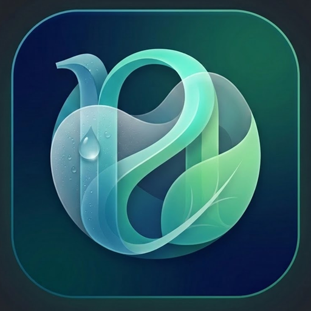
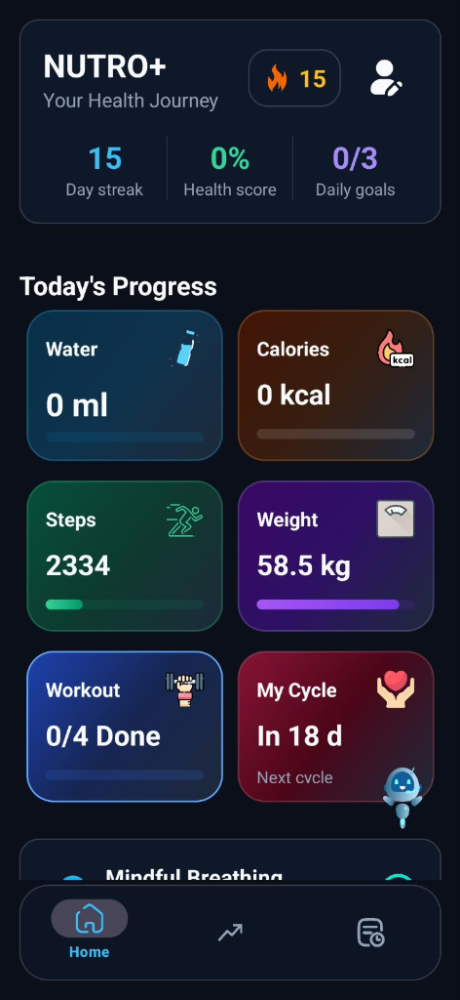
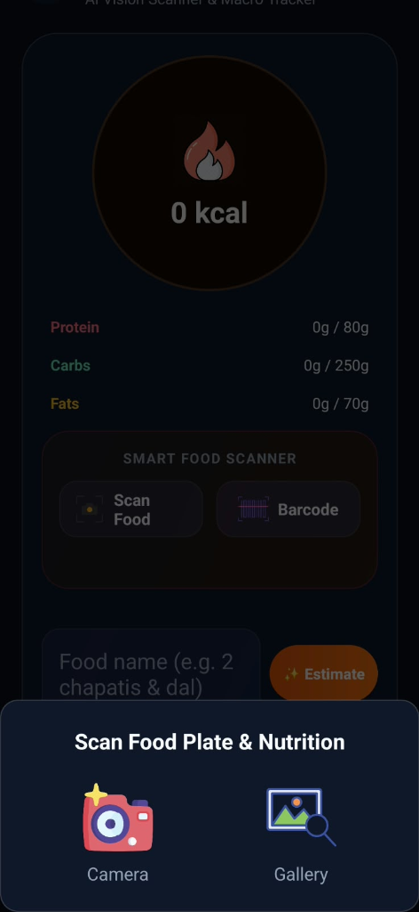

# 🍃 NUTRO & NUTRO+ AI

> **Next-Generation Nutrition Tracking & Health Intelligence Platform**  
> Modern Web Showcase, Native Android Client & AI Analytics Suite.

[](#-live-web-showcase)
[](#-live-web-showcase)
[](#-mobile-editions)
[](#)

---

## 🌐 Live Web Showcase

Click the links below to interact directly with the live NUTRO showcase:

- 🚀 **[Open Live on Vercel](https://nutro-eight.vercel.app)** *(Primary High-Performance CDN)*
- 📄 **[Open on GitHub Pages](https://workingguy4321.github.io/nutro/)** *(Official GitHub Mirror)*

---

## 📱 Mobile Editions

| Feature | 🌿 NUTRO Standard | ⚡ NUTRO+ AI Edition |
| :--- | :---: | :---: |
| **Target User** | Everyday wellness & basic food logging | High-performance athletes & health enthusiasts |
| **Calorie & Macro Tracker** | ✅ Built-in | ✅ Precision Real-Time Engine |
| **Water & Hydration Logger** | ✅ Visual Glasses | ✅ Auto-Target Hydration Engine |
| **Camera AI Food Scanner** | — | ✅ On-device CameraX Food Recognition |
| **Sree AI Voice Assistant** | — | ✅ Real-time Voice Consultation |
| **Macro Analytics Engine** | Standard Summary | ✅ Deep Trend & Caloric Forecasting |
| **Data Privacy** | 100% On-Device Encrypted | 100% On-Device Encrypted SQLite |
| **Access Requirement** | Free Download | 🔑 Security Product Key Protected |

---

## 🔑 AI Edition Product Key Access

To maintain computing resources for high-speed AI inference, **NUTRO+ AI Edition** requires an authorized product key before downloading:

```
NUTRO-2026-AI-PRO
```
*(Enter this key in the download modal on the website to initiate the APK package download).*

---

## 📸 Visual Preview

| App Logo | Interactive Dashboard | AI Food Scanner |
| :---: | :---: | :---: |
|  |  |  |

---

## 🛠️ Tech Stack

- **Web Frontend:** Pure Semantic HTML5, Modular CSS3 with Glassmorphism, Vanilla ES6+ JavaScript.
- **Design System:** Custom Dark Mode (`#070D1B`), Neon Cyan (`#06b6d4`), Amber (`#f59e0b`), Emerald (`#10b981`).
- **Icons:** Lucide Icons.
- **Android App:** Native Kotlin, Android Jetpack, CameraX, Room Database, Material Design 3.
- **Deployment:** Vercel Global Edge & GitHub Pages.

---

## 💻 Running the Website Locally

No node server, npm install, or local server required! Simply double-click:
```bash
index.html
```
The website is completely self-contained and opens instantly in any modern web browser via `file://`.
